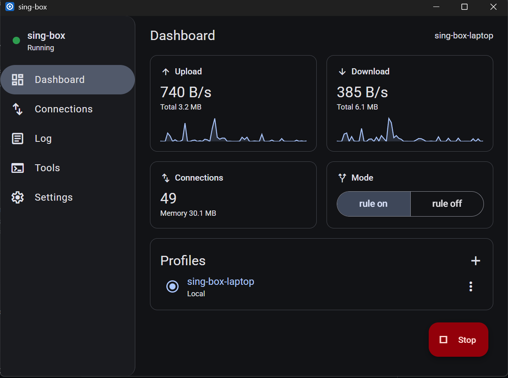

# sing-box client for Desktop

Cross-platform desktop client for [sing-box](https://github.com/SagerNet/sing-box), modeled on the
screens of SFA (sing-box for Android). Built with [Neutralinojs](https://neutralino.js.org),
Angular 22 and Angular Material. One codebase builds a small native app for every supported OS;
the UI runs in the system webview, so there is no bundled Chromium or Node.js.



## Supported platforms

| OS      | Builds                                     | Webview   | Status |
| ------- | ------------------------------------------ | --------- | ------ |
| Windows | `win_x64`                                  | WebView2  | Primary platform, fully tested |
| Linux   | `linux_x64`, `linux_arm64`, `linux_armhf`  | WebKitGTK | Implemented; tested on x64 (including WSL2/WSLg) |
| macOS   | `mac_x64`, `mac_arm64`, `mac_universal`    | WKWebView | Implemented; not yet tested on a Mac |

Runtime requirements:

- **Windows 10/11**: WebView2 runtime (always present on Windows 11, installed with Edge on Windows 10).
- **Linux**: WebKitGTK (`libwebkit2gtk-4.1`), `curl` or `wget`, `tar`; `pkexec` for TUN. Tray needs an
  AppIndicator-compatible desktop.
- **macOS**: uses the built-in WKWebView; nothing extra to install.

OS-specific behaviour (downloads, extraction, process control, elevation, notifications, file
manager, terminal) lives behind the `CorePlatform` abstraction with one implementation per OS.

## sing-box version

**Minimum: sing-box 1.14.0.** Developed and tested with 1.14.4; **Settings → Core → Update**
always installs the latest stable release.

| Feature | Needs |
| ------- | ----- |
| Dashboard, Groups, Connections, Log, profiles, system proxy, Clash mode | Clash API (`experimental.clash_api`), which the client enables automatically. Older 1.x cores may work for these screens but are not tested or supported |
| **Tools → Tailscale** (status, login, exit node, peers, ping, SSH, logout) | sing-box **1.14+**: API service (`services: [{ "type": "api" }]`), added to the config automatically, and a `tailscale` endpoint in the profile |
| **Taildrop** receive and send | sing-box **1.14+**, same as Tailscale |

With an older core the Tools screen shows "Tools need sing-box 1.14 or newer" and the rest of the
client keeps working. The official release builds include Tailscale; a self-built core needs the
`with_tailscale` build tag.

## Features

| Screen      | What it does |
| ----------- | ------------ |
| Dashboard   | Start/stop, upload/download speed and totals with graphs, connections and memory, Clash mode, system proxy, profiles; cards can be hidden in Settings |
| Groups      | Selector / URL-test groups: switch outbound, latency test. Shown only when the selected profile has groups (or in Global mode) |
| Connections | Active / closed / all, search, sort, close one or all, details screen |
| Log         | Live sing-box output, level filter, search, pause, copy, save to file |
| Profiles    | Local (new / import file) and remote (URL, auto update) profiles, import links, JSON editor (CodeMirror 6, lint, accepts comments and trailing commas like sing-box) |
| Tools       | Tailscale endpoints: status, login, exit-node dropdown, peers grouped by user, peer details with addresses, live ping chart and SSH, logout |
| Taildrop    | Receive with progress bar, auto-save to Downloads (or a chosen folder), notifications, "show in folder", recently saved list; send by file chooser or drag and drop with per-file progress |
| Settings    | Core binary (path, version, **Update** from GitHub releases), service, ports, theme, tray behaviour, notifications, Taildrop, data folder |

Desktop integration:

- **Tray** icon shows the service state; its menu has show/hide, start/stop/restart, profile and
  Clash mode switching, system proxy and quit. Closing the window can minimize to tray.
- **Notifications** and errors are shown as system notifications near the tray while the window
  is hidden or minimized, and in the window otherwise.
- **Single instance**: launching a second copy closes the running one (and any sing-box it left behind).
- Window position and size are remembered and restored on screen.

## How it works

- **Core**: sing-box is not bundled. **Settings → Core → Update** downloads the latest production
  GitHub release for the current OS and CPU into `<data>/core`.
- **Runtime**: the selected profile is written to `work/config.json` with client overrides (Clash
  API endpoint, system proxy switch, API service) and started as a child process. Live data comes
  from sing-box's Clash API; logs come from the process output.
- **Stop**: sing-box is asked to exit gracefully (CTRL_BREAK on Windows, SIGINT on Linux/macOS) so
  it can restore the system proxy and routes; it is force-killed only if that fails.
- **TUN** profiles need elevated rights; see [Administrator rights](#administrator-rights).

- **Tools / Taildrop** use sing-box's API service (`daemon.StartedService`, sing-box 1.14+), the
  same API SFA uses through libbox. The client adds an `api` service on 127.0.0.1 with a random
  secret (or reuses one the profile declares) and calls it from the webview with gRPC-Web; the
  bidirectional Taildrop send stream uses gRPC over WebSocket. SSH opens `sing-box tailscale ssh`
  in a terminal. Message definitions in `src/app/core/daemon/daemon.proto.json` are extracted from
  the sing-box binary: re-run `node scripts/extract-daemon-proto.mjs` after a core update that
  changes the API.

### Administrator rights

The client runs as a normal user. Elevated rights are needed for one thing only: **starting a
profile with a `tun` inbound**. To capture all traffic, sing-box has to:

- create a virtual network adapter (wintun on Windows, `/dev/net/tun` on Linux, utun on macOS);
- add routes for it (`auto_route`) and, with `strict_route`, firewall rules that stop traffic and
  DNS from leaking past it;
- with `cap_net_bind_service` on Linux, listen on ports below 1024.

Before starting, the client checks whether the core can do this. If it cannot, it shows
"TUN permission required" with a button:

| OS      | Button | What happens |
| ------- | ------ | ------------ |
| Windows | Restart as administrator | UAC prompt, then an elevated copy of the client starts and takes over from the current one (single instance). sing-box runs as its child, so it is elevated too |
| Linux   | Grant TUN permission | `pkexec setcap cap_net_admin,cap_net_raw,cap_net_bind_service+ep` on the core binary. The client itself stays unprivileged. Needed again after each core update, because the new binary has no capabilities |
| macOS   | Restart as administrator | Administrator password prompt, then the client is relaunched as root |

Everything else works without elevation: system proxy (a per-user setting), `mixed`/`socks`/`http`
inbounds on ports above 1024, core updates, Clash API screens, Tailscale and Taildrop.

Things to know when the client runs elevated on Windows:

- Windows blocks drag and drop from a non-elevated Explorer into an elevated window, so the
  Taildrop drop zone does not accept files; use the file chooser instead.
- If UAC asks for the credentials of a *different* administrator account, the client runs as that
  user and uses that user's data folder, profiles and settings.

### Data folder

| OS      | Location |
| ------- | -------- |
| Windows | `%APPDATA%\sing-box-client` |
| Linux   | `~/.local/share/sing-box-client` |
| macOS   | `~/Library/Application Support/sing-box-client` |

```
core/                sing-box binary (+ libcronet on Windows)
profiles/<id>.json   profile contents
profiles.json        profile list
settings.json        app settings (see BaseSettings)
work/                sing-box working directory (cache.db, rule-sets, generated config.json)
instance/            single-instance lock
taildrop-incoming/   partial Taildrop downloads before they are moved into place
```

## Code map

```
src/app/core/
  platform/                 CorePlatform + factory: Windows, Linux, macOS (shared POSIX base)
  settings/base-settings.ts BaseSettings<T>: JSON file ⇄ webview storage replication
  settings.service.ts       AppSettings (extends BaseSettings)
  box.service.ts            service lifecycle (start/stop/restart, overrides, alerts)
  clash-api.service.ts      Clash API REST + WebSocket streams
  core-binary.service.ts    core version, GitHub release download/install, `sing-box check`
  profile.service.ts        profiles CRUD, remote and auto update
  instance.service.ts       single-instance lock and takeover
  tray.service.ts, window.service.ts, app-lifecycle.service.ts
  daemon/                   API service client: gRPC-Web/WebSocket transport, models,
                            Tailscale (DaemonService) and Taildrop receive/send services
src/app/screens/            dashboard, groups, connections, log, profiles, tools (tailscale), settings
src/app/shared/             JSON editor, dialogs, formatting, sparkline
scripts/                    icon generator, daemon proto extractor
```

### Settings persistence

`BaseSettings<T>` is the base class for persisted settings groups. On load the JSON file in the data
folder is the source of truth and is copied into webview `localStorage`; every change is written to
`localStorage` immediately and replicated to the JSON file (debounced, serialized). Subclasses
provide `fileName`, `defaults` and optionally `normalize()`.

### Adding or changing platform behaviour

Implement or extend `CorePlatform` (binary and release asset names, download/extract, process
control, TUN privileges, notifications, file manager, terminal) and return it from
`createCorePlatform()` in `core/platform/core-platform.factory.ts`.

## Development

Requires Node.js ≥ 22.22.3 or ≥ 24.15 (see `.nvmrc`). Node is only needed to build; the app itself
does not use it.

```sh
npm install
npx neu update        # downloads Neutralino binaries into bin/
npm run dev           # ng serve on 127.0.0.1:5180 + Neutralino window with hot reload
npm run build:app     # self-contained binaries for all platforms → dist/sing-box-client/
```

`build:app` runs `ng build` and embeds the web resources into each binary:

```
dist/sing-box-client/
  sing-box-client-win_x64.exe
  sing-box-client-linux_x64   sing-box-client-linux_arm64   sing-box-client-linux_armhf
  sing-box-client-mac_x64     sing-box-client-mac_arm64     sing-box-client-mac_universal
```

On Linux and macOS mark the binary executable (`chmod +x`) after copying it. Routes use hash
location because Neutralino's static server cannot resolve deep links.

## License

GPL-3.0-or-later. Screen design follows SFA; no SFA source code is included.
